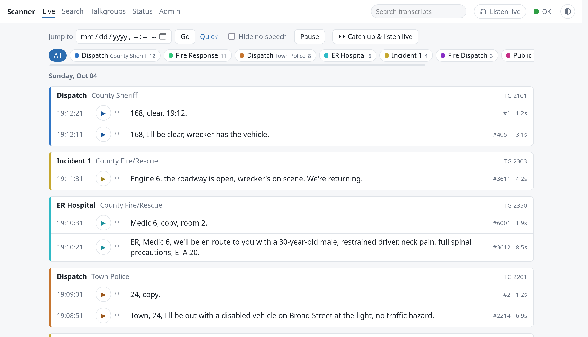
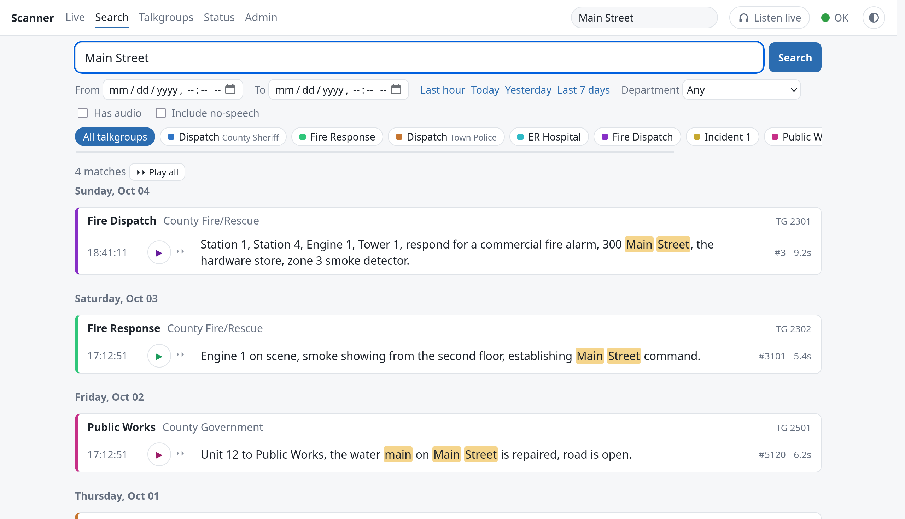
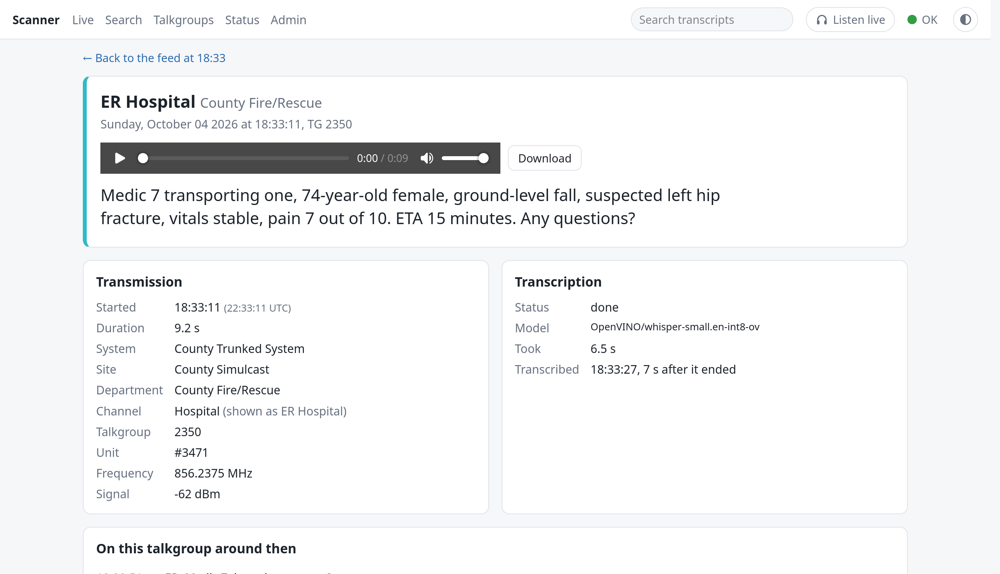
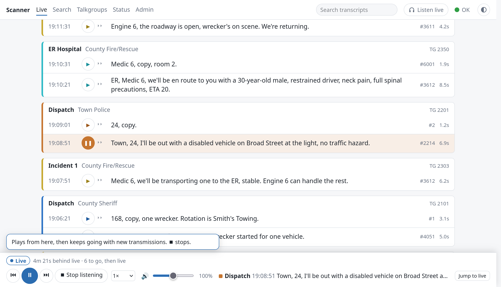
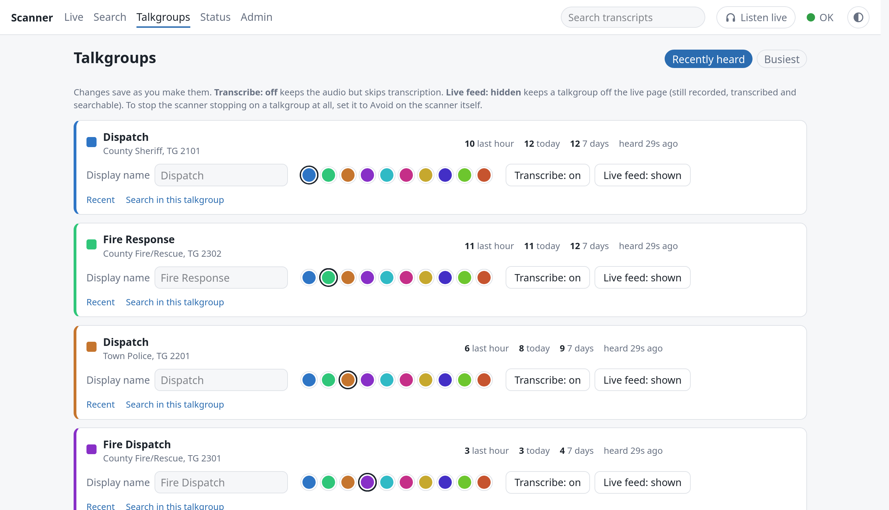
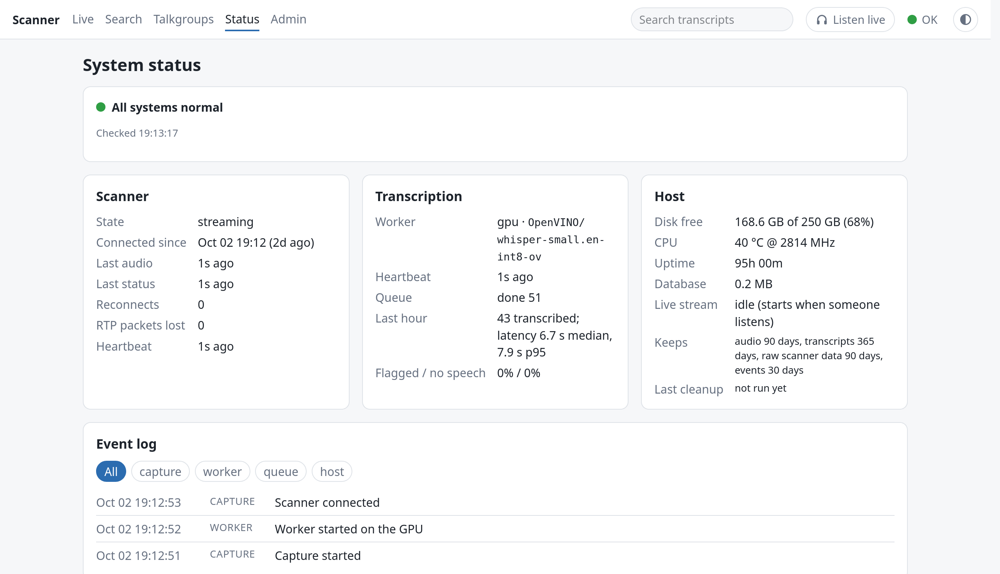
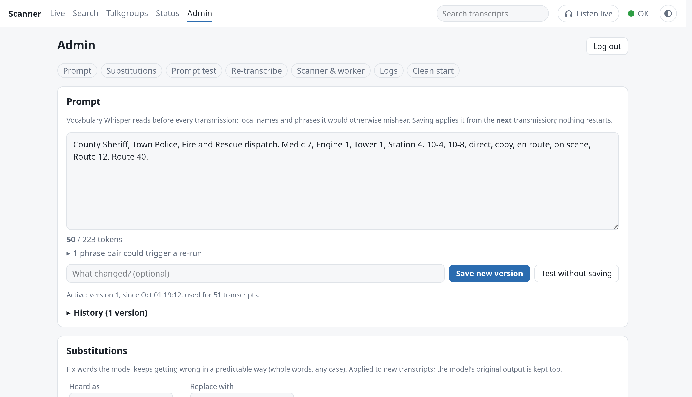
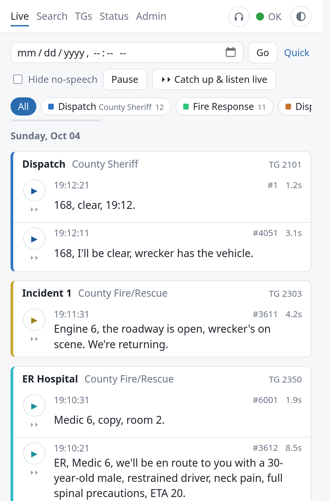
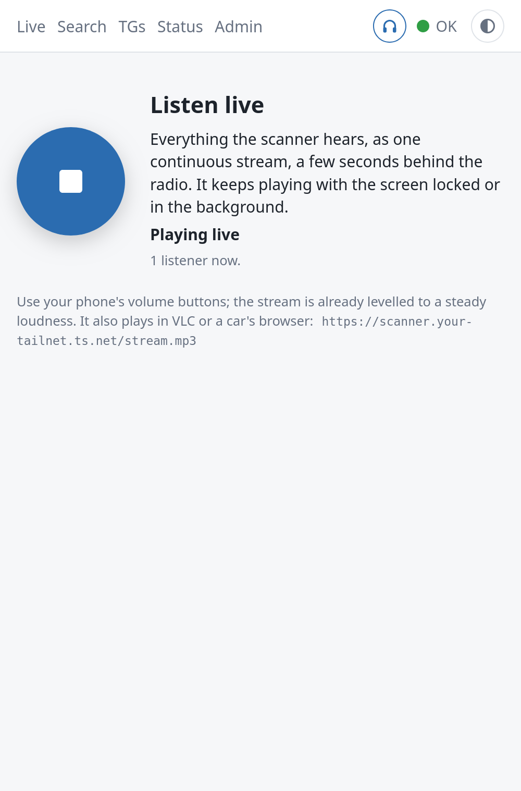

# Scanner Transcriber

**A searchable, transcribed log of everything your Uniden SDS200 hears, running on a small
Linux box at home.** It records each transmission off the scanner's network port, transcribes
it locally (no cloud, no subscription), and serves a live web page you can read, search and
listen to from your phone.

<picture>
  <source media="(prefers-color-scheme: dark)" srcset="docs/screenshots/live-dark.png">
  
</picture>

<sub>Screenshots use invented demo traffic (`tests/ui/screenshots.sh`), not real dispatch audio.</sub>

## What it does

- **Live feed.** Every transmission appears a few seconds after it ends, labelled with its
  talkgroup, department and unit ID, and colour-coded by talkgroup. Filter to the talkgroups
  you care about with one tap.
- **Local speech-to-text.** Whisper (small.en) runs on the Intel iGPU of a small mini PC,
  usually done about 7 seconds after a transmission ends. If the GPU fails, a CPU model takes
  over automatically.
- **Search everything.** Full-text search across months of transcripts, by date range,
  department or talkgroup, then play the results back to back.
- **Play it back like a scanner.** Click ⏵⏵ on any transmission to hear from there on. It
  plays through to the present and then keeps going with live traffic. Speed control, and
  quiet clips are levelled to a steady volume.
- **Listen live.** A Broadcastify-style continuous stream of whatever the scanner hears. It
  keeps playing on a locked iPhone, also works in VLC, and several people can listen at once.
- **Tune it to your area.** A vocabulary prompt (unit names, road names, local terms) and a
  find-and-replace list, edited in the browser and applied without a restart. Test a prompt
  against hand-checked clips before you save it, and re-transcribe older recordings with the
  new one.
- **Looks after itself.** It runs as two systemd services that restart after a crash or
  hang, reconnect to the scanner after an outage, and reboot the scanner remotely if its
  audio port locks up. Old audio and transcripts are cleaned up on a schedule you set.
- **Works on a phone.** Responsive pages, light and dark themes, an installable icon. Access
  it from anywhere over [Tailscale](https://tailscale.com) with HTTPS.

## Screenshots

| | |
|---|---|
|  |  |
| **Search** across every transcript, with matches highlighted | **Transmission detail**: audio, download, scanner metadata and the conversation around it |
|  |  |
| **Play from here**: catches up, then follows live | **Talkgroups**: rename, recolour, hide, or skip transcription |
|  |  |
| **Status**: scanner, transcription and host health at a glance | **Admin**: edit the vocabulary prompt, test it, re-transcribe |

<p align="center">
  
  &nbsp;&nbsp;
  
</p>

## How it works

```
                 UDP 50536: status (talkgroup, unit, channel)
 ┌─────────┐   ─────────────────────────────────────────────►  ┌──────────────────────────┐
 │ SDS200  │     RTSP 554: audio (8 kHz µ-law)                  │ capture                  │
 │ scanner │   ─────────────────────────────────────────────►  │ split into transmissions │
 └─────────┘                                                    └────────────┬─────────────┘
                                                                             │ WAV + row
                                                          ┌──────────────────▼─────────────┐
                                                          │ SQLite (WAL) + clips on disk   │
                                                          └───────┬────────────────┬───────┘
                                                                  │                │
                                                ┌─────────────────▼──┐   ┌─────────▼──────────┐
                                                │ worker             │   │ web (FastAPI+htmx) │
                                                │ Whisper on the iGPU│   │ live feed, search, │
                                                │ Parakeet on CPU    │   │ stream, admin      │
                                                └────────────────────┘   └─────────┬──────────┘
                                                                                   │
                                                                     phone / laptop over Tailscale
```

The scanner's status messages say when a transmission starts and stops and who's talking;
the audio is cut at those points. Clips are queued in SQLite, and a worker process
transcribes them one at a time. The web process reads the same database and pushes new rows
to open pages as they're transcribed.

## What you need

- **A Uniden SDS200** on your network. Tested on firmware 1.21.00, on a trunked P25 system.
  The SDS100 and other scanners aren't supported (no network audio).
- **A Linux box that's always on.** Developed on an Intel N5105 NUC (4 cores, 8 GB RAM,
  Ubuntu) with the scanner plugged straight into its Ethernet port. An Intel iGPU is strongly
  recommended: whisper-small.en runs on it through OpenVINO. Without one it falls back to a
  CPU model that's much less accurate (see [Accuracy](#accuracy)).
- **Python 3.12** via [uv](https://docs.astral.sh/uv/). It's installed for you below.
- **About 15–20 GB of disk** for 90 days of audio and a year of transcripts at typical
  county traffic levels.

> [!IMPORTANT]
> The SDS200 allows **one** network audio connection at a time. While this runs, ProScan,
> VLC or anything else can't use the scanner's audio stream. Use **Listen live** instead.

## Install

```bash
git clone https://github.com/DannyBoyk/scanner-transcriber.git
cd scanner-transcriber
curl -LsSf https://astral.sh/uv/install.sh | sh                   # once
uv sync --extra worker --extra web --extra bench                  # all extras in one command

cp config.example.toml config.toml                                # set [scanner] host to your SDS200's IP
uv run python -m scanner_transcriber probe                        # checks the scanner answers (safe)
uv run python -m scanner_transcriber set-password                 # for the Admin page
```

**iGPU drivers** (Intel): install `intel-opencl-icd` (Jasper Lake and older chips need
`intel-opencl-icd-legacy`), add yourself to the `render` group, and log in again.

**Models**: Whisper downloads itself from Hugging Face on first start. The CPU fallback
model goes in `models/`:

```bash
mkdir -p models && cd models
curl -LO https://github.com/k2-fsa/sherpa-onnx/releases/download/asr-models/sherpa-onnx-nemo-parakeet_tdt_ctc_110m-en-36000-int8.tar.bz2
tar xjf sherpa-onnx-nemo-parakeet_tdt_ctc_110m-en-36000-int8.tar.bz2 && cd ..
```

**Try it** in the foreground, in two terminals:

```bash
uv run python -m scanner_transcriber run      # capture + transcription; Ctrl-C stops cleanly
uv run python -m scanner_transcriber web      # then open http://<box>:8080 (set [web] bind)
```

**Run it as services** so it starts on boot and restarts itself:

```bash
sudo deploy/install.sh --start
systemctl status scanner-transcriber scanner-transcriber-web
deploy/update.sh                              # after a git pull: sync deps, run tests, restart
```

Logs go to `journalctl -u scanner-transcriber` (and `-web`) and `data/logs/`. The units are
sandboxed: read-only system, write access only to `data/` and `~/.cache`.

### Access from anywhere (HTTPS)

Keep `[web] bind = "127.0.0.1"` and let Tailscale put HTTPS in front of it:

```bash
sudo tailscale serve --bg http://127.0.0.1:8080
```

Or set `bind = "*"` to serve plain HTTP on your LAN. Reading the feed needs no login; the
Admin page and talkgroup changes need the password.

## Configuration

Everything lives in `config.toml`; [`config.example.toml`](config.example.toml) documents
every option. The ones you'll likely touch:

| Setting | Default | What it's for |
|---|---|---|
| `[scanner] host` | | Your SDS200's IP address |
| `[scanner] auto_reboot` | `true` | Reboot the scanner remotely if its audio port locks up (see below) |
| `[web] bind`, `port` | `127.0.0.1`, `8080` | Where the web UI listens |
| `[web] timezone` | system | e.g. `"America/New_York"` |
| `[retention] audio_days` | `90` | Delete clip audio after this (transcripts stay) |
| `[retention] transcript_days` | `365` | Delete whole transcripts after this |

The vocabulary prompt and substitutions are edited on the **Admin** page, not in the file.
Put your agencies, unit naming patterns ("Medic 7", "Engine 13-3"), town and road names in
the prompt; it makes a big difference to accuracy.

## Performance

Measured on the N5105 over a 47-hour soak test with real county traffic (5,452
transmissions, 4.7 hours of speech):

| | |
|---|---|
| Transcript appears | median **7 s** after the transmission ends (95% within 10 s) |
| Busiest hour | 327 transmissions, worker busy 68% of the time, nothing waited more than 7 s |
| Memory | about 1.1–1.3 GB for the worker, 150–180 MB for the web, flat over days |
| CPU temperature | 30–50 °C, no throttling |
| Disk | about 140 MB of audio and 10 MB of database per day |
| Reliability | no restarts, no reconnects, no lost audio, no failed transcriptions |

Ten simultaneous Listen live streams used 3% CPU. Details in
[`docs/m5-plan.md`](docs/m5-plan.md#soak-report-8-9).

## Accuracy

Radio is hard for speech-to-text: clipped first syllables, codes, unit numbers, local
place names. On a hand-checked set of 89 recent transmissions, Whisper small.en with a
local prompt has a word error rate of **0.18**, about one word in six wrong. Longer transmissions are
noticeably better than that, and the transcripts are good enough to read along and to search.

The weak spots are **one- or two-word replies** ("Direct", "10-4", a bare unit number) and
the **first word** of a transmission. A trick that's built in: half a second of silence is
added before short clips, which cut their error rate by about a sixth. The CPU fallback
(Parakeet 110M) is much worse (WER about 0.56) and is there to keep the log going, not to
replace the GPU. The experiments are written up in
[`docs/stt-accuracy-2026-10.md`](docs/stt-accuracy-2026-10.md) and
[`docs/m0-results.md`](docs/m0-results.md).

## Things to know about the SDS200

Learned the hard way, and handled in the code:

- **Audio lockout.** If a connection to the scanner's audio port is dropped without a clean
  RTSP TEARDOWN, it can refuse new connections until rebooted: a `kill -9`, or the cable
  out for more than about a minute. Capture always sends a TEARDOWN, even for connections
  that failed. If the port still locks up, it reboots the scanner with the remote command
  `MSM,0` (at most once every 15 minutes), and the Admin page has a **Reboot scanner**
  button. Write-up and sources:
  [`docs/sds200-rtsp-lockout.md`](docs/sds200-rtsp-lockout.md). **Never `kill -9` capture**;
  `systemctl stop`/`restart` are safe.
- The network audio is continuous 8 kHz µ-law and **exact digital silence while muted**.
  Status pushes (about 4 a second) carry the talkgroup, department, channel and unit ID,
  and line up with the audio within about 250 ms.
- The scanner can stay unmuted from one unit's transmission straight into another's reply,
  so clips are also split when the unit ID changes.
- Some transmissions start mid-word because the scanner unmutes late. That happens before
  the audio reaches us.
- The front-panel volume doesn't affect the network audio.

## Commands

All run as `uv run python -m scanner_transcriber <command>` (or `.venv/bin/python -m …`).

| Command | What it does |
|---|---|
| `probe` | Asks the scanner (UDP only) for its model, firmware and status. Always safe. |
| `run [--no-worker]` | Capture and transcription (what the main service runs). |
| `web` | The web UI (what the web service runs). Also `/healthz` and a JSON API under `/api/`. |
| `worker [--drain]` | Only the transcription worker, e.g. to catch up on a backlog. |
| `status` | Health from the command line: scanner, worker, queue, latency, disk, recent events. |
| `set-password [--clear]` | Sets the Admin password. |
| `retention [--dry-run] [--vacuum]` | Runs cleanup now (it also runs hourly); `--vacuum` compacts the database. |
| `sample-recent`, `draft`, `label`, `bench`, `evaluate` | Build a hand-checked clip set and measure accuracy; see [`docs/development.md`](docs/development.md). |

## Development

```bash
uv run pytest                    # about 300 tests
tests/ui/run_all.sh              # browser checks in headless Firefox (scratch instances)
tests/ui/screenshots.sh          # regenerate these screenshots from demo data
```

The design and each milestone's plan and results are in
[`scanner-transcriber-design.md`](scanner-transcriber-design.md) and [`docs/`](docs/).
Benchmarking and labelling notes are in [`docs/development.md`](docs/development.md).

## Ideas not built yet

- Listen live over cellular/CarPlay: a network hiccup while the phone is locked stops the
  stream (iOS blocks the page's reconnect). A bigger buffer or HLS would fix it.
- Better recognition of one-word replies and bare unit numbers by matching against a known
  list.
- Recovery from an audio lockout after a `kill -9` without a reboot.

## License

[0BSD](LICENSE): use, copy, change and share it for any purpose, no credit required.
It comes as is, with no warranty.

---

Not affiliated with or endorsed by Uniden. Listening to and recording radio traffic is
legal in many places but not all, and rebroadcasting it may not be. Check your local laws
before you share a stream or transcripts.
